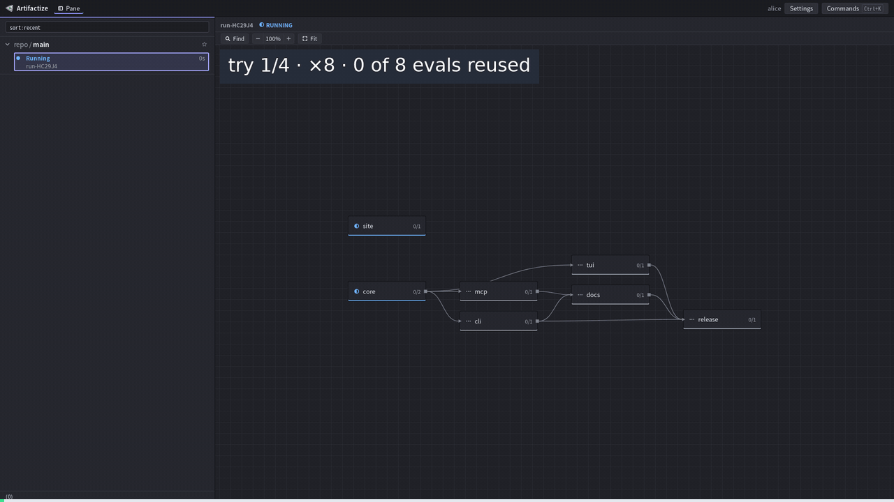
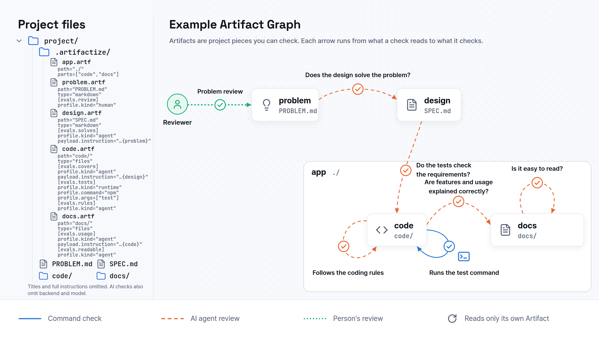

[](https://github.com/lhj6102/artifactize/actions/workflows/ci.yml)
[](https://crates.io/crates/artifactize)
[](LICENSE)
[](https://github.com/lhj6102/artifactize/releases/latest/download/Artifactize.dmg)
[](https://apps.microsoft.com/detail/9PB6W4LL165D)
[](https://github.com/lhj6102/artifactize/releases/latest/download/Artifactize-amd64.deb)

English · [한국어](assets/readme/README.kr.md) · Homepage: [artifactize.dev](https://artifactize.dev)

# Artifactize: Evaluation-driven development for people and AI agents.

Artifactize checks your project piece by piece—from code and documents to images and the running app—with tests, AI agent reviews, and human sign-offs. Each reviewed piece is an **Artifact**, each check on it is an **eval**, and each verification session is a **Run** that records the checks and their results so you and your teammates can trust what AI agents changed without watching every step.

Test runners check code and review bots check pull requests in isolation. Artifactize connects tests, AI agent reviews, and human sign-offs on one **Artifact Graph**, a project-wide map of your Artifacts and the inputs each check reads: only checks whose inputs changed run again, while unchanged checks reuse their earlier results across branches, teammates, and CI.

## At a glance

Declare each Artifact and its checks in the small `.artf` language under `.artifactize/`, then run `artifactize verify`:

```rust
// .artifactize/api.artf
profile sol = agent(backend = "codex", model = "gpt-6.2-sol", reasoning = "high")

artf api : files = {
  path = "crates/api/"

  eval tests : runtime(command = "cargo", args = ["test", "--locked"]) = {
    title = "API tests pass"
    instruction = "Run the API's test suite."
  }

  eval matches-spec : sol = {
    title = "API implementation matches the specification"
    instruction = "Review @{artf self} against @{artf spec}. Each route that does not match is an issue."
  }
}
```

```sh
$ artifactize verify --all --wait
  spec/approved    [run-8fK2a1-1]: GREEN (reused from run-3bX9q0)
  api/tests        [run-8fK2a1-2]: GREEN
  api/matches-spec [run-8fK2a1-3]: GREEN
Summary: executed 2 (runtime 1, agent 1, human 0), reused 1 (human 1)
```

<p align="center">
  
</p>

## Quick Start

### 1. Install

**Download the desktop app** (includes the `artifactize` CLI):
- **macOS** (Apple silicon & Intel): [Artifactize.dmg](https://github.com/lhj6102/artifactize/releases/latest/download/Artifactize.dmg) — drag to Applications and open once.
- **Windows** (x64): [Artifactize in the Microsoft Store](https://apps.microsoft.com/detail/9PB6W4LL165D), then open a new terminal.
- **Linux** (x86_64 Ubuntu 22.04 / Debian 12+): [Artifactize-amd64.deb](https://github.com/lhj6102/artifactize/releases/latest/download/Artifactize-amd64.deb) (`sudo apt install ./Artifactize-amd64.deb`).

Or install from the command line:

| System | Command |
|---|---|
| Linux (x86_64, aarch64, WSL 2), desktop app on x86_64 | `curl -fsSL https://artifactize.dev/install.sh \| sh` |
| macOS with [Homebrew](https://brew.sh/) | `brew install lhj6102/tap/artifactize` (add `--cask` for the desktop app too) |
| macOS without Homebrew | `curl -fsSL https://artifactize.dev/install.sh \| sh` |
| Windows (Microsoft Store via winget) | `winget install 9PB6W4LL165D --source msstore` |

See the [installation guide](https://artifactize.dev/docs/getting-started/install.html) for PowerShell (`irm https://artifactize.dev/install.ps1 | iex`), AppImage, Cargo, and source builds.

**Add the plugin to Claude Code or Codex** so your coding agent gets **Arti** (Artifactize's project guide) and the inspection and verification tools:

```sh
claude plugin marketplace add lhj6102/artifactize && claude plugin install artifactize@artifactize   # Claude Code
codex plugin marketplace add lhj6102/artifactize && codex plugin add artifactize@artifactize         # Codex
```

Or paste this prompt into Claude Code or Codex to let your agent set up both the CLI and the plugin:

```text
Install Artifactize on this machine following https://artifactize.dev/docs/getting-started/install.html, then add its plugin to yourself following https://artifactize.dev/docs/agent-plugin/plugin.html.
```

### 2. Try your first task

In your project directory, ask Arti (in Codex, write `$artifactize:hey-arti`):

```text
/artifactize:hey-arti Explain Artifactize and tell me how we could apply it to this project
```

Arti reads your repository, asks what matters to your team, and proposes Artifacts and checks. After you agree, it writes the `.artf` declarations under `.artifactize/` and runs your first `verify`. To try Artifactize without an AI account, follow the [5-minute quick start](https://artifactize.dev/docs/getting-started/guide.html).

## How it works

1. Evaluations define the result; AI agents iterate until it passes.
2. Tests, AI agents and people can all be equal evaluators, each good at different evaluations.
3. Each evaluated result becomes part of the next evaluation, all the way to the final result.

## Highlights

<p align="center">
  
</p>

| Feature | What it does |
|---|---|
| **Artifact Graph** | Declare each file, folder, or live URI with an `artf` statement under `.artifactize/`, with `path`, `parts`, and the inputs its evals name (`@{artf spec}`), so dependencies are explicit; macros write what repeats once. |
| **Three kinds of checks** | Combine `runtime` commands (tests, linters), `agent` reviews (LLM judgment with read-only tools), and `human` sign-offs in one workflow. |
| **Input-based reuse** | Content fingerprints (`artifactsum` by default) track what each check reads; unchanged inputs reuse earlier verdicts across branches, teammates, and CI. |
| **Durable Runs** | `artifactize verify` runs in the background while agents fix failing checks, and requests human sign-offs only after automated checks pass. |
| **Desktop app** | Work with the built-in agent in **Chat**, track Runs in **Verify** and read declarations as code on a Current, and claim or complete Human reviews in **Review**. |
| **Artifact viewers** | Give an Artifact a type to reuse its review tools. Open files, Markdown, or scoped Artifactize declarations in a dedicated viewer. Use Point in supported viewers to add a location to your review. |

## Learn more

- [Documentation](https://artifactize.dev/docs/): concepts, guides, examples, and CLI/MCP reference.
- [Community on Discord](https://discord.gg/VswgKkPkS9): questions, ideas, and help.
- [License](LICENSE): open source under Apache License 2.0.
