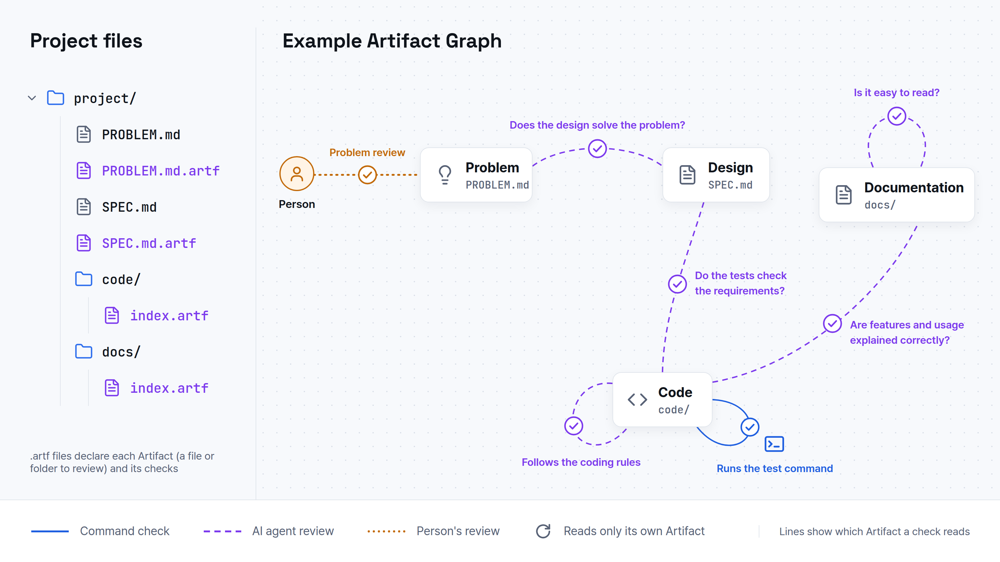
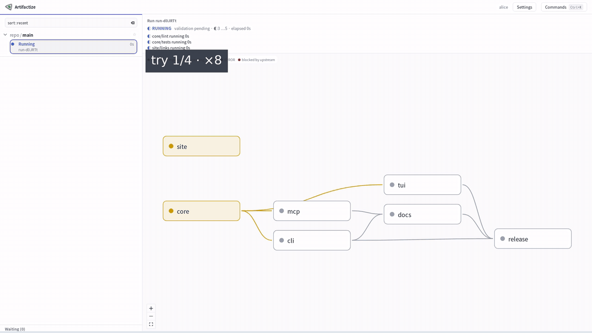
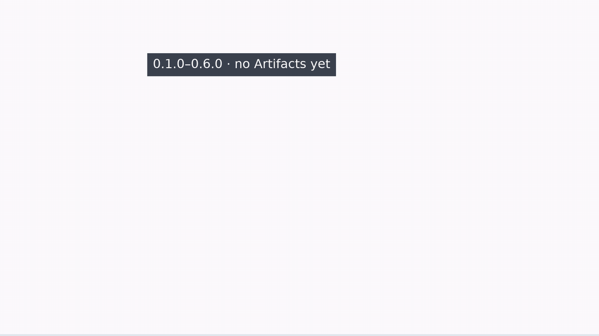
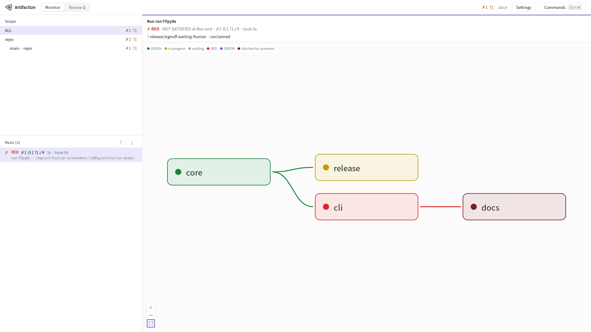
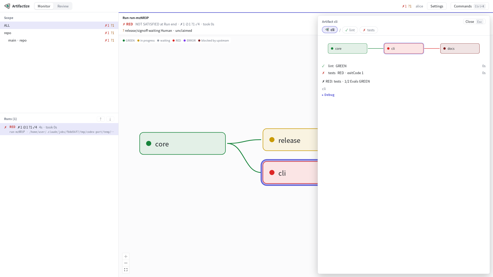
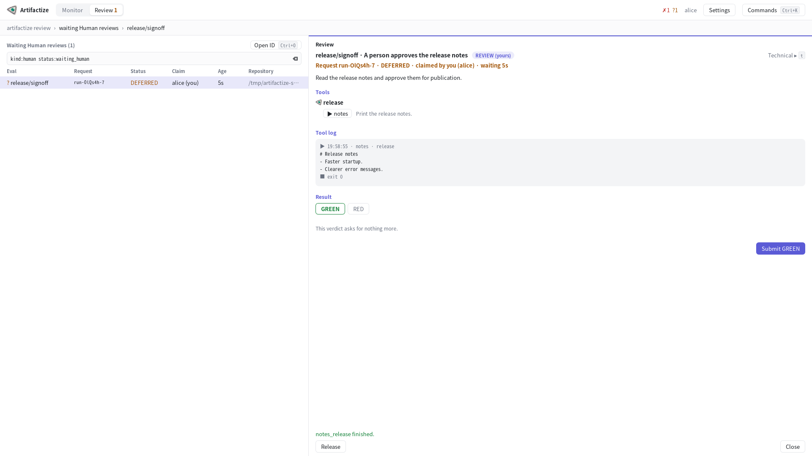

[](https://github.com/lhj6102/artifactize/actions/workflows/ci.yml)
[](https://crates.io/crates/artifactize)
[](LICENSE)

English · [한국어](assets/readme/README.kr.md)

Homepage: [artifactize.dev](https://artifactize.dev)

# Build together on an Artifact Graph.

<p align="center">
  
</p>

**Who is it for?**

- People who want to build together with others, reviewing efficiently and developing in modules.
- People who want to trust changes made by AI agents without overseeing every step.
- People who want code, documents, images, and running applications to stay consistent as the project grows.

<p align="center">
  
</p>

<p align="center">
  <a href="https://github.com/user-attachments/assets/6aafdfbe-e41c-4b90-b435-dab7bfdd28b6">
    
  </a>
  <br>
  <sub>27-second introduction, no sound. Select it for the full-quality video.</sub>
</p>

**Our principles**

- We don't restrict how you build. Use your preferred tools and agent harnesses (the apps that run your AI assistants).
- We don't restrict individuality. Create freely within loose guardrails.
- AI doesn't make every decision. Vision, taste, and important decisions about direction remain in human hands.

An **Artifact** is a piece of the project: code, writing, a design or an image.
The **graph** shows how these pieces connect. Give each piece its own checks—a test,
an AI review or a person's sign-off. When the work a check looked at hasn't changed,
Artifactize can use its earlier result again, even across project versions and teammates’ copies.

Checks keep running while you step away. Each verification has a tracking code
called a Run ID; closing the command window doesn't stop it.

## Install

Download the app for your operating system. It brings the `artifactize` command
with it, so you do not need Rust’s build tools.

- **macOS**: [Download Artifactize.dmg](https://github.com/lhj6102/artifactize/releases/latest/download/Artifactize.dmg),
  one disk image for Apple silicon and Intel. Drag Artifactize to Applications and
  open it once to set up the Terminal command.
- **Windows**: [Get Artifactize from the Microsoft Store](https://apps.microsoft.com/detail/9PB6W4LL165D)
  (x64), then open a new terminal.
- **Linux**: [Download the .deb](https://github.com/lhj6102/artifactize/releases/latest/download/Artifactize-amd64.deb)
  for x86_64 Ubuntu 22.04, Debian 12 or later, and open it with your software
  installer or run `sudo apt install ./Artifactize-amd64.deb`.

### From the command line

**Linux** (x86_64 and aarch64; also WSL 2 on Windows), with the desktop app on x86_64:

```sh
curl -fsSL https://artifactize.dev/install.sh | sh
```

**macOS**, with [Homebrew](https://brew.sh/):

```sh
brew install lhj6102/tap/artifactize
```

For the desktop app with the commands, use `brew install --cask lhj6102/tap/artifactize`
instead. Without Homebrew, the install script installs both:
`curl -fsSL https://artifactize.dev/install.sh | sh`

**Windows**, from the Microsoft Store; then open a new terminal:

```powershell
winget install 9PB6W4LL165D --source msstore
```

The [full installation guide](https://artifactize.dev/docs/getting-started/install.html)
explains the alternatives—the PowerShell install script, AppImage, Cargo and building
from source—along with prerequisites, updates and uninstalling.

### Quick start with Arti

We recommend starting with a conversation with Arti, Artifactize's guide inside your
coding assistant. Arti explains Artifactize in terms of your own project, helps you
move the tests and reviews you already have, or sets up a new project with you.
Its [plugin](https://artifactize.dev/docs/agent-plugin/plugin.html) gives Claude Code
and Codex [Hey Arti](https://artifactize.dev/docs/agent-plugin/hey-arti.html)'s
instructions and Artifactize's tools in one install:

```text
/plugin marketplace add lhj6102/artifactize          # Claude Code, in a session
/plugin install artifactize@artifactize
codex plugin marketplace add lhj6102/artifactize     # Codex, in a terminal
codex plugin add artifactize@artifactize
```

**With your coding agent**, start with one of these (in Codex, write
`$artifactize:hey-arti` instead):

```text
/artifactize:hey-arti Explain Artifactize and tell me how we could apply it to this project
/artifactize:hey-arti Help me move our existing tests and reviews into Artifactize
/artifactize:hey-arti Help me start this project with Artifactize from the beginning
```

To try Artifactize without an AI account first, take the
[5-minute quick start](https://artifactize.dev/docs/getting-started/guide.html).
It uses an example project and needs no provider access key (API key).

## Learn more

- [Documentation](https://artifactize.dev/docs/): concepts, guides, examples and command reference.
- [Community on Discord](https://discord.gg/VswgKkPkS9): questions, ideas and help.
- [Source and license](LICENSE): open source under Apache License 2.0.

## The product running

These are real recordings and screenshots of the desktop app, made by scripts
([demos](assets/capture/demos.mts), [screenshots](assets/capture/screenshots.mts)) from
projects they verify for real. The example reviewer "alice" claims a sign-off to show
the review form; nothing is submitted. The text-based app (CLI) also provides Monitor
and Review screens.

**Fix until it passes:** four Runs of an example, eight times faster. Between Runs the
recording script removes what failed, standing in for an AI fixing the code; work that
didn't change is reused at once.



**How this project grew:** Artifactize's own Artifact graph at each release, from
0.7.0 to today.



**Branches and Runs:** the example's branch with its Run chips and the sign-off waiting
in the left pane, and its Run: core passed, cli's tests failed so docs is blocked, and
release waits for a person's sign-off.



**Detail:** cli between the core it uses and the docs that use it, with its checks.



**Review:** the release sign-off, opened from the waiting reviews and claimed by the
example reviewer, after running its notes tool, with the GREEN form open.


