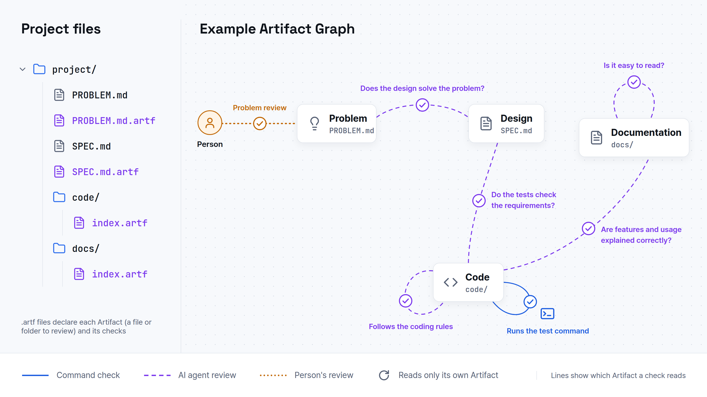
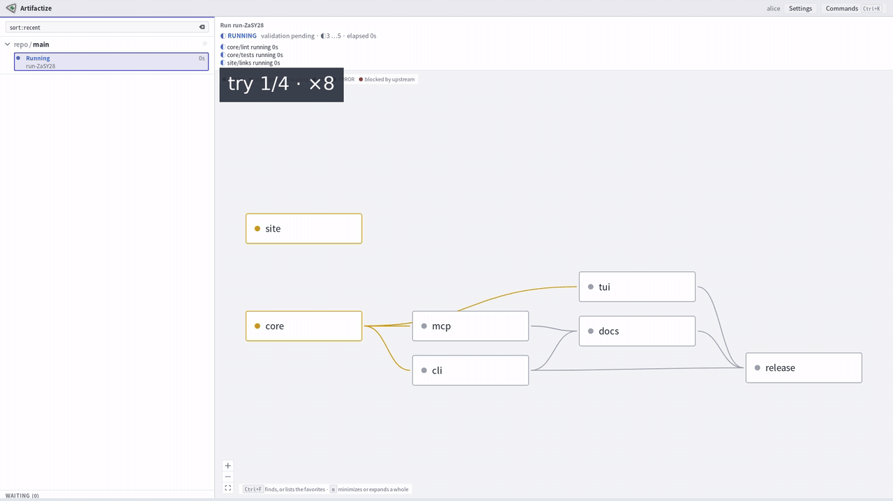
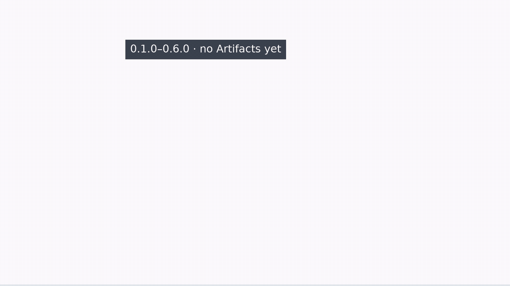
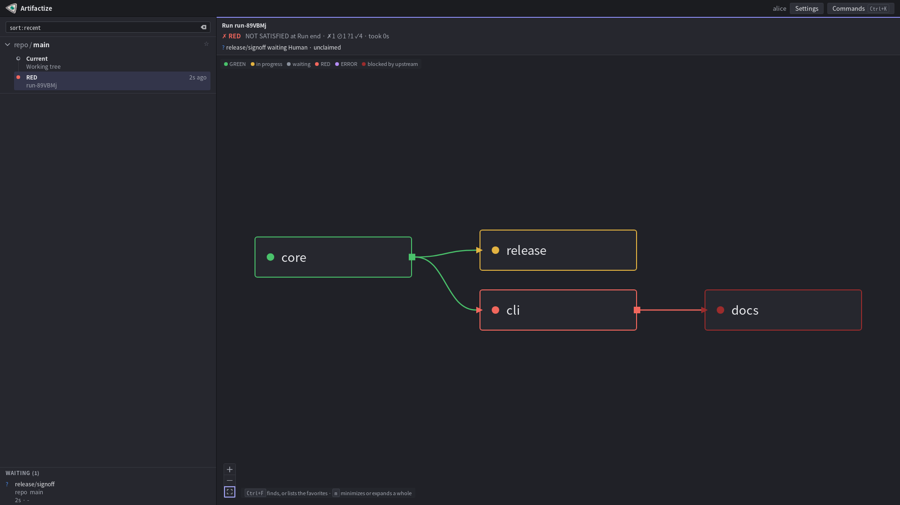
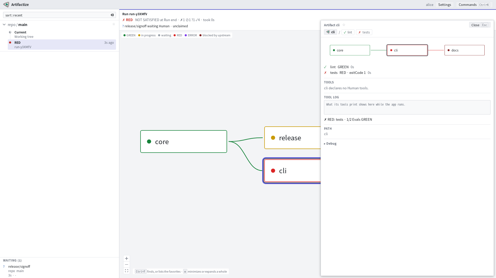
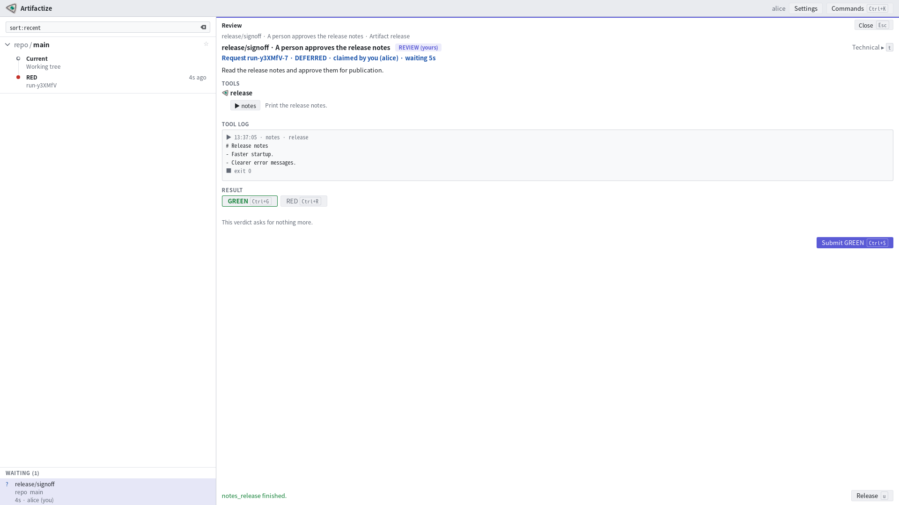

[](https://github.com/lhj6102/artifactize/actions/workflows/ci.yml)
[](https://crates.io/crates/artifactize)
[](LICENSE)
[](https://github.com/lhj6102/artifactize/releases/latest/download/Artifactize.dmg)
[](https://apps.microsoft.com/detail/9PB6W4LL165D)
[](https://github.com/lhj6102/artifactize/releases/latest/download/Artifactize-amd64.deb)

English · [한국어](assets/readme/README.kr.md)

Homepage: [artifactize.dev](https://artifactize.dev)

# Artifactize: Evaluation-driven development for people and AI agents.

Artifactize checks your project piece by piece, from code and documents to images and the
running app, with tests, AI reviews and people's sign-offs. It remembers every result, so
work that hasn't changed is never checked twice, and you can trust what you and your AI
agents changed without watching every step.

Test runners check code and review bots check pull requests. Artifactize puts both, and the
people who sign off, on one Artifact Graph of your whole project: every check knows what it
reads, runs again only when that changes, and keeps going while you step away.

<p align="center">
  
</p>

## Demo

<p align="center">
  <a href="https://github.com/user-attachments/assets/6aafdfbe-e41c-4b90-b435-dab7bfdd28b6">
    
  </a>
</p>

## Quick Start

### 1. Install

Pick whichever fits how you work.

**Download the app.** It brings the `artifactize` command with it, so you do not need
Rust's build tools. Your coding agent has nothing new yet: add the plugin below before
your first task.

- **macOS**: [Artifactize.dmg](https://github.com/lhj6102/artifactize/releases/latest/download/Artifactize.dmg),
  one disk image for Apple silicon and Intel. Drag Artifactize to Applications and open it
  once to set up the Terminal command.
- **Windows**: [Artifactize in the Microsoft Store](https://apps.microsoft.com/detail/9PB6W4LL165D)
  (x64), then open a new terminal.
- **Linux**: [Artifactize-amd64.deb](https://github.com/lhj6102/artifactize/releases/latest/download/Artifactize-amd64.deb)
  for x86_64 Ubuntu 22.04, Debian 12 or later: open it with your software installer or run
  `sudo apt install ./Artifactize-amd64.deb`.

Or install from the command line:

| System | Command |
|---|---|
| Linux (x86_64 and aarch64; also WSL 2), desktop app on x86_64 | `curl -fsSL https://artifactize.dev/install.sh \| sh` |
| macOS with [Homebrew](https://brew.sh/) | `brew install lhj6102/tap/artifactize` (add `--cask` for the desktop app too) |
| macOS without Homebrew | `curl -fsSL https://artifactize.dev/install.sh \| sh` |
| Windows, from the Microsoft Store | `winget install 9PB6W4LL165D --source msstore`, then open a new terminal |

The [installation guide](https://artifactize.dev/docs/getting-started/install.html) covers
the PowerShell script, AppImage, Cargo, building from source, updates and uninstalling.

**Add the plugin to your coding agent.** The
[plugin](https://artifactize.dev/docs/agent-plugin/plugin.html) gives Claude Code and Codex
Arti, Artifactize's guide, and Artifactize's tools. It runs the `artifactize` command, so
install that first.

```sh
claude plugin marketplace add lhj6102/artifactize && claude plugin install artifactize@artifactize   # Claude Code
codex plugin marketplace add lhj6102/artifactize && codex plugin add artifactize@artifactize         # Codex
```

**Or let your coding agent set it up.** Paste this into Claude Code or Codex; afterwards
it has the command and the plugin, so you can go straight to your first task:

```text
Install Artifactize on this machine following https://artifactize.dev/docs/getting-started/install.html, then add its plugin to yourself following https://artifactize.dev/docs/agent-plugin/plugin.html.
```

### 2. Try your first task

In your project, ask Arti (in Codex, write `$artifactize:hey-arti`):

```text
/artifactize:hey-arti Explain Artifactize and tell me how we could apply it to this project
```

Arti reads your project, asks what matters to you and proposes Artifacts and checks for it.
It changes your declarations only after you agree, and you get back your project's first
Artifact Graph and a `verify` you can run. To try Artifactize without an AI account, take
the [5-minute quick start](https://artifactize.dev/docs/getting-started/guide.html) with an
example project.

## How it works

1. Evaluations define the result; AI agents iterate until it passes.
2. Tests, AI agents and people are equal evaluators, each with its own strengths.
3. Each evaluated result becomes part of the next evaluation, all the way to the final result.

## Highlights

<p align="center">
  
</p>

| Feature | What it does |
|---|---|
| Artifact Graph | Each piece of the project, an Artifact, declares its own checks and what it reads, so the graph shows how the pieces connect. |
| Three kinds of checks | A command such as your tests, a review by an AI agent, or a person's sign-off. |
| Reuse | A check whose inputs did not change keeps its earlier result, across versions and teammates' copies. |
| Runs that keep going | Each verification is a Run with its own ID; closing the window does not stop it. |
| Desktop app | Watch Runs live on the graph, open any Artifact and sign off where you are asked to. |

**Who is it for?**

- People who want to build together with others, reviewing efficiently and developing in modules.
- People who want to trust changes made by AI agents without overseeing every step.
- People who want code, documents, images, and running applications to stay consistent as the project grows.

**Our principles**

- We don't restrict how you build. Use your preferred tools and agent harnesses (the apps that run your AI assistants).
- We don't restrict individuality. Create freely within loose guardrails.
- AI doesn't make every decision. Vision, taste, and important decisions about direction remain in human hands.

## The product running

These are real recordings and screenshots of the desktop app, made by scripts
([demos](assets/capture/demos.mts), [screenshots](assets/capture/screenshots.mts)) from
projects they verify for real. The example reviewer "alice" claims a sign-off to show
the review form; nothing is submitted. The text-based app (CLI) also provides Monitor
and Review screens.

**Fix until it passes:** four Runs of an example, eight times faster. Between Runs the
recording script removes what failed, standing in for an AI fixing the code; work that
didn't change is reused at once.



**How this project grew:** Artifactize's own Artifact graph at each release, from
0.7.0 to today.



**Branches and Runs:** the example's branch with its Run chips and the sign-off waiting
in the left pane, and its Run: core passed, cli's tests failed so docs is blocked, and
release waits for a person's sign-off.



**Detail:** cli between the core it uses and the docs that use it, with its checks.



**Review:** the release sign-off, opened from the waiting reviews and claimed by the
example reviewer, after running its notes tool, with the GREEN form open.



## Learn more

- [Documentation](https://artifactize.dev/docs/): concepts, guides, examples and command reference.
- [Community on Discord](https://discord.gg/VswgKkPkS9): questions, ideas and help.
- [Source and license](LICENSE): open source under Apache License 2.0.
