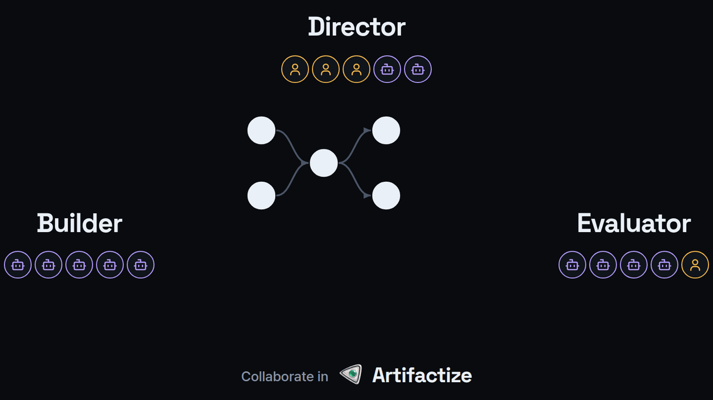

[](https://github.com/lhj6102/artifactize/actions/workflows/ci.yml)
[](https://crates.io/crates/artifactize)
[](../../LICENSE)

[English](../../README.md) · 한국어

# Build together on an Artifact Graph.

<p align="center">
  
</p>

**누구를 위한 도구인가요?**

- 다른 사람과 함께 만들면서 효율적으로 리뷰하고 모듈 단위로 개발하고 싶은 사람.
- AI 에이전트가 일하는 과정을 일일이 지켜보지 않고도 에이전트가 바꾼 내용을 믿고 싶은 사람.
- 프로젝트가 커져도 코드, 문서, 이미지, 실행 중인 애플리케이션이 서로 어긋나지 않기를 바라는 사람.

<p align="center">
  
</p>

<p align="center">
  <a href="https://github.com/user-attachments/assets/6aafdfbe-e41c-4b90-b435-dab7bfdd28b6">
    
  </a>
  <br>
  <sub>27초 소개 영상, 소리 없음. 선택하면 원본 화질 영상을 볼 수 있습니다.</sub>
</p>

**우리의 원칙**

- 만드는 방식을 제한하지 않습니다. 원하는 도구와 에이전트 하네스(AI 어시스턴트를 실행하는 앱)를 그대로 쓰세요.
- 개성을 제한하지 않습니다. 느슨한 규칙 안에서 자유롭게 만드세요.
- AI가 모든 것을 결정하지 않습니다. 비전, 취향, 방향에 관한 중요한 결정은 사람이 내립니다.

**Artifact**는 프로젝트의 한 조각입니다. 코드, 글, 디자인이나 이미지가 될 수 있습니다.
**Artifact Graph**는 이 조각들이 어떻게 연결되는지 보여 줍니다. 조각마다 테스트, AI 리뷰,
사람의 승인 같은 검사를 붙이세요. 검사 대상이 바뀌지 않았다면 Artifactize는 이전 결과를
재사용할 수 있습니다. 프로젝트의 다른 버전이나 팀원의 작업 사본에서도 마찬가지입니다.

자리를 비운 동안에도 검사는 계속 실행됩니다. Run마다 Run ID라는 추적 코드가
붙고, 터미널을 닫아도 Run은 멈추지 않습니다.

## 설치

사용하는 운영체제에 맞는 앱을 내려받으세요. 앱에 `artifactize` 명령이
함께 들어 있으므로 Rust 빌드 도구는 필요 없습니다.

- **macOS**: [Artifactize.dmg 내려받기](https://github.com/lhj6102/artifactize/releases/latest/download/Artifactize.dmg).
  디스크 이미지 하나로 Apple 실리콘 Mac과 Intel Mac에 모두 설치할 수 있습니다. Artifactize를 응용 프로그램 폴더로 끌어다 놓고
  한 번 열면 터미널에서 artifactize 명령을 쓸 수 있습니다.
- **Windows**: [Microsoft Store에서 Artifactize 받기](https://apps.microsoft.com/detail/9PB6W4LL165D)
  (x64). 설치한 뒤 새 터미널을 여세요.
- **Linux**: x86_64 Ubuntu 22.04, Debian 12 이상용 [.deb 내려받기](https://github.com/lhj6102/artifactize/releases/latest/download/Artifactize-amd64.deb).
  소프트웨어 설치 프로그램으로 열거나
  `sudo apt install ./Artifactize-amd64.deb`를 실행하세요.

### 명령줄에서 설치

**Linux** (x86_64와 aarch64, Windows의 WSL 2 포함). x86_64에서는 데스크톱 앱도 함께 설치됩니다.

```sh
curl -fsSL https://artifactize.dev/install.sh | sh
```

**macOS**, [Homebrew](https://brew.sh/) 사용:

```sh
brew install lhj6102/tap/artifactize
```

명령과 함께 데스크톱 앱도 설치하려면 대신 `brew install --cask lhj6102/tap/artifactize`를
쓰세요. Homebrew가 없다면 설치 스크립트가 둘 다 설치합니다.
`curl -fsSL https://artifactize.dev/install.sh | sh`

**Windows**, Microsoft Store에서 설치한 뒤 새 터미널을 여세요.

```powershell
winget install 9PB6W4LL165D --source msstore
```

[전체 설치 안내](https://artifactize.dev/docs/ko/getting-started/install.html)에서
다른 방법(PowerShell 설치 스크립트, AppImage, Cargo, 소스에서 빌드)과
사전 요구 사항, 업데이트, 제거 방법을 설명합니다.

### Arti와 함께 빠르게 시작하기

Arti와 대화하면서 시작해 보기를 권합니다. Arti는 코딩 어시스턴트 안에서 Artifactize를 안내합니다.
지금 프로젝트를 예로 들어 Artifactize를 설명하고, 기존 테스트와 리뷰를 옮기거나
새 프로젝트를 준비하도록 돕습니다.
[플러그인](https://artifactize.dev/docs/ko/agent-plugin/plugin.html) 하나만 설치하면 Claude Code와
Codex에서 [Hey Arti](https://artifactize.dev/docs/ko/agent-plugin/hey-arti.html)의 안내를
받으며 Artifactize 도구를 쓸 수 있습니다.

```text
/plugin marketplace add lhj6102/artifactize          # Claude Code, 세션 안에서
/plugin install artifactize@artifactize
codex plugin marketplace add lhj6102/artifactize     # Codex, 터미널에서
codex plugin add artifactize@artifactize
```

**코딩 에이전트에게** 이렇게 말을 걸어 보세요(Codex에서는 `$artifactize:hey-arti`로
쓰세요).

```text
/artifactize:hey-arti 아티팩타이즈에 대해 설명해주고 이 프로젝트에 어떻게 적용하면 좋을지 얘기해줘
/artifactize:hey-arti 지금 있는 테스트와 리뷰를 아티팩타이즈로 옮기도록 도와줘
/artifactize:hey-arti 이 프로젝트를 아티팩타이즈로 처음부터 시작하도록 도와줘
```

AI 계정 없이 먼저 써 보고 싶다면
[5분 빠른 시작](https://artifactize.dev/docs/ko/getting-started/guide.html)을 따라 해 보세요.
예제 프로젝트를 쓰므로 API 키도 필요 없습니다.

## 더 알아보기

- [문서](https://artifactize.dev/docs/ko/): 개념, 가이드, 예제, 명령 레퍼런스.
- [Discord 커뮤니티](https://discord.gg/VswgKkPkS9): 질문, 아이디어, 도움.
- [소스와 라이선스](../../LICENSE): Apache License 2.0으로 공개된 오픈 소스입니다.

## 실제로 동작하는 제품

아래는 데스크톱 앱의 실제 녹화와 스크린샷입니다. 실제 프로젝트에서 검사를 실행하는 화면을
스크립트([데모](../capture/demos.mts), [스크린샷](../capture/screenshots.mts))로
녹화하고 촬영했습니다. 예시 리뷰어 "alice"는 리뷰 양식을 보여 주려고 승인 요청을
맡았을 뿐, 리뷰 결과를 제출하지는 않았습니다. 텍스트 기반 앱(CLI)에도 Monitor와
Review 화면이 있습니다.

**통과할 때까지 고치기:** 한 예제에서 Run을 네 번 실행하는 과정을 8배속으로 보여 줍니다. Run 사이에는
AI가 코드를 고치는 대신 녹화 스크립트가 실패한 부분을 지웁니다. 바뀌지 않은
부분은 이전 결과를 바로 재사용합니다.


**이 프로젝트의 성장 과정:** Artifactize 자체의 Artifact Graph가 0.7.0부터 지금까지
릴리스마다 어떻게 성장했는지 보여 줍니다.


**브랜치와 Run:** 왼쪽 패널에 Run 칩과 승인할 요청이 있는 예제 브랜치가 보이고, 그 Run에서는
core가 통과했고, cli의 테스트가 실패해 docs는 막혔으며, release는 사람이 승인해야
진행됩니다.


**Detail:** cli와 cli의 검사 목록을 보여 주고, 양옆에 cli가 사용하는 core와 cli를 사용하는 docs를 함께 보여 줍니다.


**Review:** 예시 리뷰어가 승인 요청 목록에서 release 승인 요청을 열고 리뷰를 맡은 다음, notes 도구를 실행하고 GREEN 양식을 열어 둔 화면입니다.


