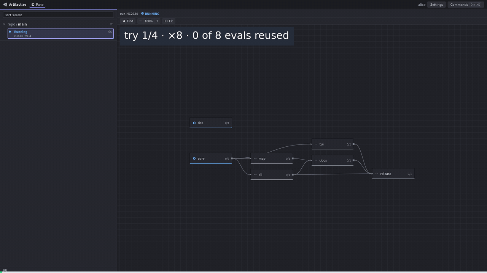
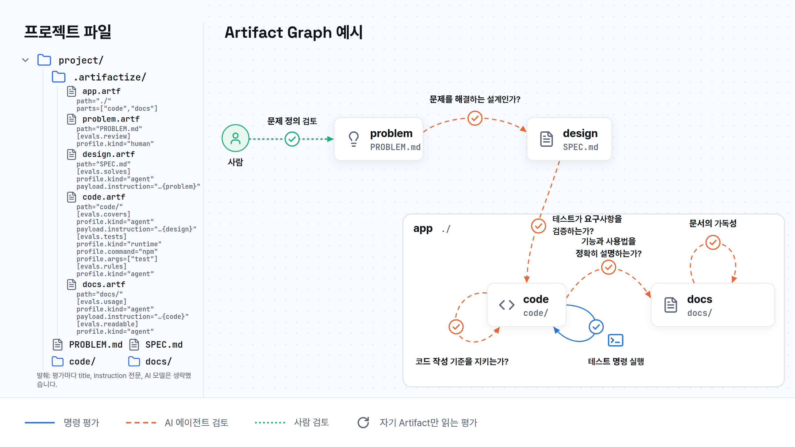

[](https://github.com/lhj6102/artifactize/actions/workflows/ci.yml)
[](https://crates.io/crates/artifactize)
[](../../LICENSE)
[](https://github.com/lhj6102/artifactize/releases/latest/download/Artifactize.dmg)
[](https://apps.microsoft.com/detail/9PB6W4LL165D)
[](https://github.com/lhj6102/artifactize/releases/latest/download/Artifactize-amd64.deb)

[English](../../README.md) · 한국어 · 홈페이지: [artifactize.dev](https://artifactize.dev)

# Artifactize: Evaluation-driven development for people and AI agents.

Artifactize는 프로젝트의 코드, 문서, 이미지, 실행 중인 앱을 평가합니다. 테스트를 실행하거나 AI 에이전트에 리뷰를 맡길 수 있습니다. 사람이 직접 확인하고 승인하는 절차도 넣을 수 있습니다. 평가 대상을 **Artifact**, Artifact마다 설정하는 개별 평가를 **eval**이라고 부릅니다. 검증을 한 번 실행할 때마다 **Run**을 만들고, 각 평가와 그 결과를 Run에 기록합니다. 팀원들은 AI 에이전트의 작업 과정을 일일이 지켜보지 않아도 결과를 믿을 수 있습니다.

기존 테스트 러너는 코드만 따로 평가하고, 리뷰 봇은 풀 리퀘스트만 따로 봅니다. Artifactize는 프로젝트의 모든 Artifact와 각 평가에 필요한 입력을 하나의 **Artifact Graph**로 연결합니다. 덕분에 테스트, AI 에이전트 리뷰, 사람의 승인을 하나의 워크플로에서 관리할 수 있습니다. 평가마다 어떤 Artifact를 입력으로 쓰는지 지정해 둡니다. 입력이 바뀌면 그 평가를 다시 실행합니다. 다른 브랜치나 팀원의 개발 환경, CI에서도 평가 입력이 그대로라면 이전 결과를 재사용합니다.

## 한눈에 보기

`.artifactize/` 아래에 작은 `.artf` 언어로 각 Artifact와 평가를 선언하고, Agent 평가를 실행할 방식은 `.artfprofiles` 파일에 적은 뒤 `artifactize verify`를 실행합니다.

```rust
// .artifactize/profiles.artfprofiles
profile reviewer : agent = { backend = "codex", model = "gpt-6.2-sol", reasoning = "high" }
```

```rust
// .artifactize/api.artf
artf api : files = {
  path = "crates/api/"

  // Run the API's test suite.
  eval tests : runtime(command = "cargo", args = ["test", "--locked"]) = {
    title = "API tests pass"
  }

  eval matches-spec : reviewer = {
    title = "API implementation matches the specification"
    instruction = "Review @{artf self} against @{artf spec}. Each route that does not match is an issue."
  }
}
```

```sh
$ artifactize verify --all --wait
  spec/approved    [run-8fK2a1-1]: GREEN (reused from run-3bX9q0)
  api/tests        [run-8fK2a1-2]: GREEN
  api/matches-spec [run-8fK2a1-3]: GREEN
Summary: executed 2 (runtime 1, agent 1, human 0), reused 1 (human 1)
```

<p align="center">
  
</p>

## 빠르게 시작하기

### 1. 설치

**데스크톱 앱 다운로드** (`artifactize` CLI가 함께 설치됩니다):
- **macOS** (Apple 실리콘 및 Intel): [Artifactize.dmg](https://github.com/lhj6102/artifactize/releases/latest/download/Artifactize.dmg)를 응용 프로그램 폴더로 옮긴 뒤 한 번 실행하세요.
- **Windows** (x64): [Microsoft Store의 Artifactize](https://apps.microsoft.com/detail/9PB6W4LL165D)를 설치한 뒤 새 터미널을 여세요.
- **Linux** (x86_64 Ubuntu 22.04 / Debian 12 이상): [Artifactize-amd64.deb](https://github.com/lhj6102/artifactize/releases/latest/download/Artifactize-amd64.deb)를 다운로드해 `sudo apt install ./Artifactize-amd64.deb`로 설치하세요.

명령줄에서 바로 설치할 수도 있습니다.

| 시스템 | 명령 |
|---|---|
| Linux: x86_64·aarch64 및 WSL 2 지원(x86_64에는 데스크톱 앱도 설치) | `curl -fsSL https://artifactize.dev/install.sh \| sh` |
| [Homebrew](https://brew.sh/)를 쓰는 macOS | `brew install lhj6102/tap/artifactize` (데스크톱 앱까지 설치하려면 `--cask`를 붙이세요) |
| Homebrew를 쓰지 않는 macOS | `curl -fsSL https://artifactize.dev/install.sh \| sh` |
| Windows (winget으로 Microsoft Store 버전 설치) | `winget install 9PB6W4LL165D --source msstore` |

PowerShell 스크립트(`irm https://artifactize.dev/install.ps1 | iex`), AppImage, Cargo로 설치하는 방법과 소스 코드를 직접 빌드하는 방법은 [설치 가이드](https://artifactize.dev/docs/ko/getting-started/install.html)에서 확인할 수 있습니다.

**Claude Code나 Codex에 플러그인 추가하기** — 플러그인을 추가하면 조회·검증 도구와 **Arti** 스킬을 쓸 수 있습니다. Arti는 프로젝트에 Artifactize를 적용하는 방법을 안내합니다.

```sh
claude plugin marketplace add lhj6102/artifactize && claude plugin install artifactize@artifactize   # Claude Code
codex plugin marketplace add lhj6102/artifactize && codex plugin add artifactize@artifactize         # Codex
```

또는 아래 문장을 Claude Code나 Codex에 붙여 넣어 CLI와 플러그인 설치를 에이전트에게 바로 맡길 수 있습니다.

```text
Install Artifactize on this machine following https://artifactize.dev/docs/ko/getting-started/install.html, then add its plugin to yourself following https://artifactize.dev/docs/ko/agent-plugin/plugin.html.
```

### 2. 첫 작업 해 보기

프로젝트 폴더에서 Arti에게 다음과 같이 요청하세요(Codex에서는 아래 예시의 명령만 `$artifactize:hey-arti`로 바꿔 입력하세요).

```text
/artifactize:hey-arti Artifactize를 설명하고 이 프로젝트에 어떻게 적용할 수 있을지 알려 줘
```

Arti는 저장소를 살펴보고 팀에서 중요하게 여기는 기준을 물은 뒤, 프로젝트에 맞는 Artifact와 평가를 제안합니다. 제안에 동의하면 Arti가 `.artifactize/` 아래에 `.artf` 선언을 작성하고 `verify`로 첫 검증을 실행합니다. AI 서비스에 가입하지 않고 먼저 체험해 보려면 [5분 빠른 시작](https://artifactize.dev/docs/ko/getting-started/guide.html)을 따라 해 보세요.

## 동작 방식

1. 평가를 설정할 때 결과물이 충족해야 할 기준을 적습니다. AI 에이전트는 평가를 통과할 때까지 결과물을 고칩니다.
2. 평가할 때는 테스트를 실행해도 되고, AI 에이전트에 리뷰를 맡겨도 되고, 사람이 직접 검토해도 됩니다. 세 방식 가운데 어느 쪽을 써도 되니 확인할 내용에 맞춰 고르세요.
3. 평가를 마치면 그 결과물을 다음 평가의 입력으로 넘깁니다. 이 과정을 반복해 최종 결과물을 완성합니다.

## 주요 특징

<p align="center">
  
</p>

| 기능 | 설명 |
|---|---|
| **Artifact Graph** | `.artifactize/` 아래의 `artf` 문에서 `path`와 `parts`로 대상 파일이나 폴더, Live URI를 지정합니다. eval이 `@{artf spec}`처럼 가리키는 입력으로 의존 관계를 드러내고, 반복되는 부분은 매크로로 한 번만 씁니다. |
| **세 종류의 평가** | 한 워크플로에서 세 가지 평가 방식을 모두 쓸 수 있습니다. `runtime`에서는 테스트나 린터를 실행하고, `agent`에서는 LLM이 읽기 전용 도구로 평가 대상을 살펴보고 판정하며, `human`에서는 사람이 승인합니다. |
| **입력 기반 재사용** | 평가에 쓰는 입력 내용으로 fingerprint(기본값 `artifactsum`)를 계산해 입력이 바뀌었는지 확인합니다. 다른 브랜치에서도 평가 입력이 바뀌지 않았다면 이전 결과를 그대로 재사용합니다. 팀원의 개발 환경과 CI에서도 마찬가지입니다. |
| **백그라운드에서 계속 실행되는 Run** | `artifactize verify`로 시작한 Run은 백그라운드에서 실행됩니다. 에이전트가 평가에서 드러난 문제를 고치는 동안에도 Run은 계속 실행됩니다. 모든 자동 평가를 통과해야 Artifactize가 사람에게 승인을 요청합니다. |
| **데스크톱 앱** | **Chat**에서 내장 에이전트와 작업합니다. **Verify**에서 Run을 살펴보고, Current에서 선언을 코드로 읽습니다. **Review**에서는 Human 리뷰를 맡아 판정을 제출합니다. |
| **Artifact 뷰어** | Artifact의 유형을 지정해 리뷰 도구를 재사용합니다. 전용 뷰어에서 파일, Markdown, 지정한 범위의 Artifactize 선언을 엽니다. Point를 지원하는 뷰어에서는 리뷰에 위치를 남길 수 있습니다. |

## 더 알아보기

- [문서](https://artifactize.dev/docs/ko/): 핵심 개념, 가이드, 예제, CLI 및 MCP 레퍼런스를 확인할 수 있습니다.
- [Discord 커뮤니티](https://discord.gg/VswgKkPkS9): 질문을 올리고, 아이디어를 나누고, 도움을 요청할 수 있습니다.
- [라이선스](../../LICENSE): Apache License 2.0에 따라 소스 코드를 공개합니다.
