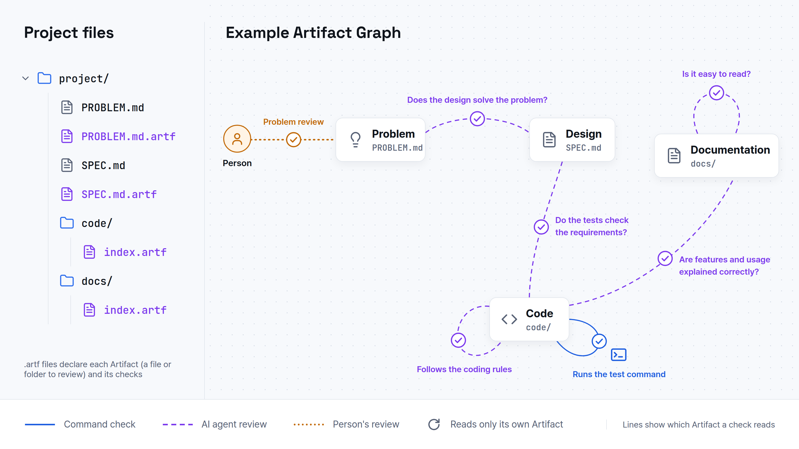
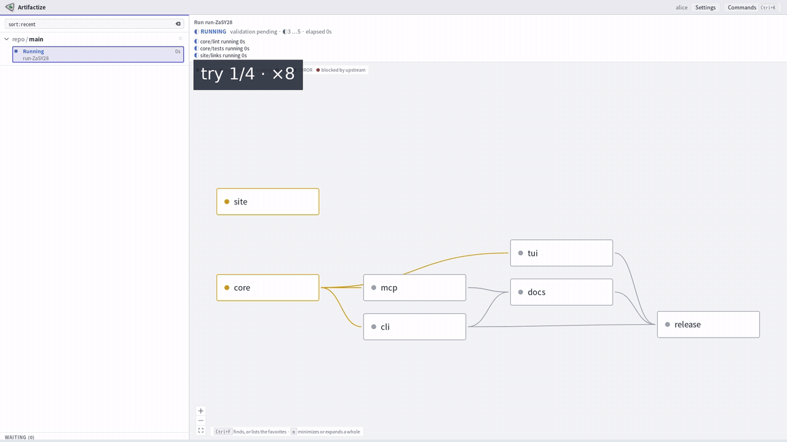
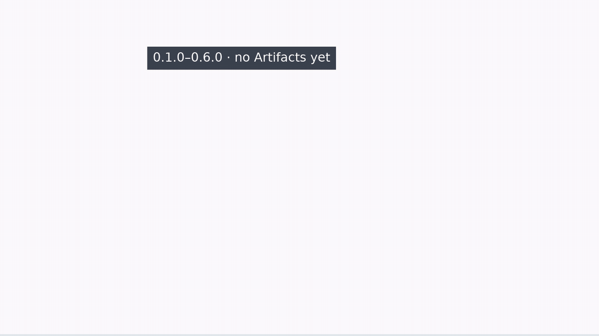
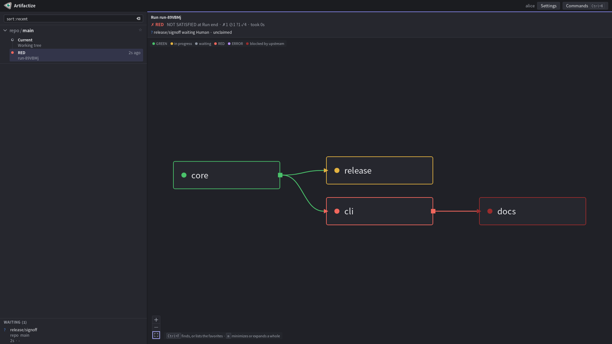
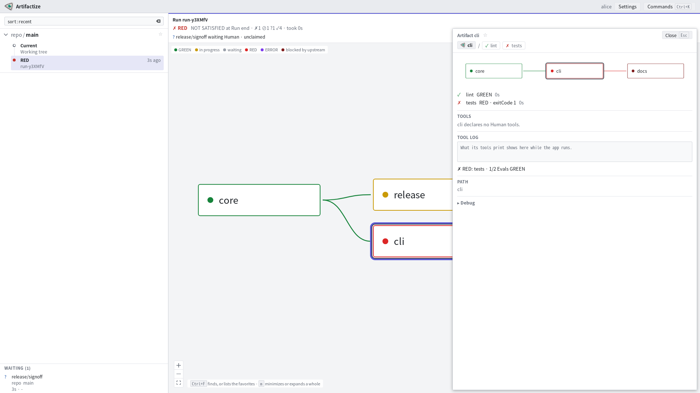
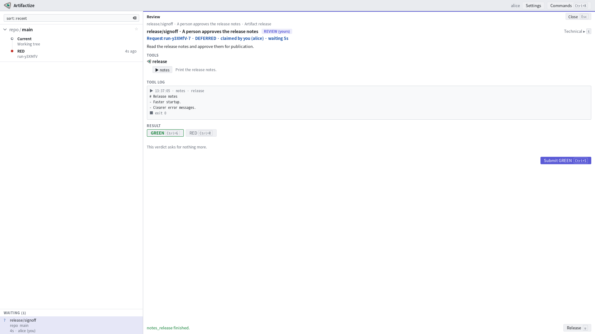

[](https://github.com/lhj6102/artifactize/actions/workflows/ci.yml)
[](https://crates.io/crates/artifactize)
[](../../LICENSE)
[](https://github.com/lhj6102/artifactize/releases/latest/download/Artifactize.dmg)
[](https://apps.microsoft.com/detail/9PB6W4LL165D)
[](https://github.com/lhj6102/artifactize/releases/latest/download/Artifactize-amd64.deb)

[English](../../README.md) · 한국어

홈페이지: [artifactize.dev](https://artifactize.dev)

# Artifactize: Evaluation-driven development for people and AI agents.

Artifactize는 코드와 문서, 이미지, 실행 중인 앱 등 프로젝트의 각 구성 요소를 테스트와 AI 리뷰,
사람의 승인으로 검사합니다. 모든 검사 결과를 저장해 두므로 바뀌지 않은 작업은 다시 검사하지 않으며,
나와 AI 에이전트가 바꾼 내용을 일일이 확인하지 않아도 작업 결과를 믿을 수 있습니다.

테스트 러너는 코드를, 리뷰 봇은 풀 리퀘스트를 검사합니다. Artifactize는 프로젝트 전체를
하나의 Artifact Graph로 관리하면서 이 두 검사와 사람의 승인을 함께 연결합니다. 각 검사가 읽는 입력을
추적해 입력이 바뀔 때만 검사를 다시 실행하고, 사용자가 자리를 비워도 작업을 계속합니다.

<p align="center">
  
</p>

## 데모

<p align="center">
  <a href="https://github.com/user-attachments/assets/6aafdfbe-e41c-4b90-b435-dab7bfdd28b6">
    
  </a>
</p>

## 빠르게 시작하기

### 1. 설치

작업 방식에 맞는 방법을 고르세요.

**앱을 내려받습니다.** 앱에 `artifactize` 명령이 함께 들어 있어서 Rust 빌드 도구가 필요하지
않습니다. 코딩 에이전트에는 아직 아무것도 추가되지 않으므로, 첫 작업 전에 아래 플러그인을
추가하세요.

- **macOS**: [Artifactize.dmg](https://github.com/lhj6102/artifactize/releases/latest/download/Artifactize.dmg).
  디스크 이미지 하나로 Apple silicon과 Intel Mac에 모두 설치할 수 있습니다. Artifactize를 응용 프로그램 폴더로
  끌어 놓고, 한 번 열어 터미널 명령을 설정하세요.
- **Windows**: [Microsoft Store의 Artifactize](https://apps.microsoft.com/detail/9PB6W4LL165D)
  (x64)를 설치한 뒤 새 터미널을 여세요.
- **Linux**: x86_64 Ubuntu 22.04, Debian 12 이상용
  [Artifactize-amd64.deb](https://github.com/lhj6102/artifactize/releases/latest/download/Artifactize-amd64.deb)을
  소프트웨어 설치 프로그램으로 열거나 `sudo apt install ./Artifactize-amd64.deb`를 실행하세요.

명령줄에서 설치할 수도 있습니다.

| 시스템 | 명령 |
|---|---|
| Linux(x86_64, aarch64, Windows의 WSL 2 포함), x86_64에서는 데스크톱 앱 포함 | `curl -fsSL https://artifactize.dev/install.sh \| sh` |
| [Homebrew](https://brew.sh/)를 쓰는 macOS | `brew install lhj6102/tap/artifactize` (데스크톱 앱도 설치하려면 `--cask`를 붙이세요) |
| Homebrew를 쓰지 않는 macOS | `curl -fsSL https://artifactize.dev/install.sh \| sh` |
| Microsoft Store를 쓰는 Windows | `winget install 9PB6W4LL165D --source msstore`를 실행한 뒤 새 터미널을 여세요 |

[설치 가이드](https://artifactize.dev/docs/ko/getting-started/install.html)에서 PowerShell 스크립트·AppImage·Cargo를
이용한 설치 방법, 소스 빌드 방법, 업데이트 및 제거 방법을 볼 수 있습니다.

**코딩 에이전트에 플러그인을 추가합니다.**
[플러그인](https://artifactize.dev/docs/ko/agent-plugin/plugin.html)은 Claude Code와 Codex에
Artifactize의 안내자인 Arti와 Artifactize의 도구를 함께 추가합니다. 플러그인은 `artifactize`
명령을 실행하므로 그 명령을 먼저 설치하세요.

```sh
claude plugin marketplace add lhj6102/artifactize && claude plugin install artifactize@artifactize   # Claude Code
codex plugin marketplace add lhj6102/artifactize && codex plugin add artifactize@artifactize         # Codex
```

**코딩 에이전트에게 설치를 맡길 수도 있습니다.** 아래 내용을 Claude Code나 Codex에 붙여 넣으세요.
설치가 끝나면 에이전트에 명령과 플러그인이 모두 갖춰지므로 바로 첫 작업으로 넘어가면 됩니다.

```text
Install Artifactize on this machine following https://artifactize.dev/docs/getting-started/install.html, then add its plugin to yourself following https://artifactize.dev/docs/agent-plugin/plugin.html.
```

### 2. 첫 작업 해 보기

프로젝트에서 Arti에게 이렇게 요청하세요(Codex에서는 `$artifactize:hey-arti`로 쓰세요).

```text
/artifactize:hey-arti Artifactize를 설명하고 이 프로젝트에 어떻게 적용할 수 있을지 알려 줘
```

Arti는 프로젝트를 읽고 무엇이 중요한지 물은 뒤, 그에 맞는 Artifact와 검사를 제안합니다. Arti는
동의를 받은 뒤에만 선언을 수정하고, 프로젝트의 첫 Artifact Graph와 바로 실행할 수 있는
`verify`를 준비해 줍니다. AI 계정 없이 먼저 써 보고 싶다면 예제 프로젝트로 진행하는
[5분 빠른 시작](https://artifactize.dev/docs/ko/getting-started/guide.html)을 따라 해 보세요.

## 동작 방식

1. 검사로 결과물의 조건을 정하면, AI 에이전트가 검사를 통과할 때까지 결과물을 고쳐 나갑니다.
2. 테스트, AI 에이전트, 사람 모두 같은 자격으로 검사를 맡고, 저마다 잘 확인하는 부분이 다릅니다.
3. 검사를 통과한 결과물은 다음 검사의 입력이 되고, 이렇게 최종 결과물까지 이어집니다.

## 주요 특징

<p align="center">
  
</p>

| 기능 | 하는 일 |
|---|---|
| Artifact Graph | 프로젝트의 각 구성 요소인 Artifact에 검사와 검사에 필요한 입력을 선언하면, Artifact Graph에서 구성 요소 사이의 연결 관계를 확인할 수 있습니다. |
| 세 종류의 검사 | 테스트 같은 명령, AI 에이전트의 리뷰, 사람의 승인입니다. |
| 재사용 | 입력이 바뀌지 않은 검사는 이전 결과를 그대로 씁니다. 다른 버전이나 팀원의 작업 사본에서도 마찬가지입니다. |
| 계속 진행되는 Run | 검사를 실행할 때마다 ID가 붙은 Run이 만들어지고, 창을 닫아도 멈추지 않습니다. |
| 데스크톱 앱 | 그래프에서 Run을 실시간으로 지켜보고, 원하는 Artifact를 열어 보고, 승인 요청을 확인해 바로 처리할 수 있습니다. |

**누구를 위한 도구인가요?**

- 다른 사람과 함께 만들면서 효율적으로 리뷰하고 모듈 단위로 개발하고 싶은 사람.
- AI 에이전트가 일하는 과정을 일일이 지켜보지 않고도 에이전트가 바꾼 내용을 믿고 싶은 사람.
- 프로젝트가 커져도 코드, 문서, 이미지, 실행 중인 앱이 서로 어긋나지 않기를 바라는 사람.

**우리의 원칙**

- 만드는 방식을 제한하지 않습니다. 원하는 도구와 에이전트 하네스(AI 어시스턴트를 실행하는 앱)를 그대로 쓰세요.
- 개성을 제한하지 않습니다. 느슨한 규칙 안에서 자유롭게 만드세요.
- AI가 모든 것을 결정하지 않습니다. 비전, 취향, 방향에 관한 중요한 결정은 사람이 내립니다.

## 실제로 동작하는 제품

아래는 데스크톱 앱의 실제 녹화 영상과 스크린샷입니다. 실제 프로젝트에서 검사를 실행하는 화면을
스크립트([데모](../capture/demos.mts), [스크린샷](../capture/screenshots.mts))로
녹화하고 촬영했습니다. 예시 리뷰어 "alice"는 리뷰 양식을 보여 주려고 승인 요청을
맡았을 뿐, 리뷰 결과를 제출하지는 않았습니다. 텍스트 기반 앱(CLI)에도 Monitor와
Review 화면이 있습니다.

**통과할 때까지 고치기:** 한 예제에서 Run을 네 번 실행하는 과정을 8배속으로 보여 줍니다. Run 사이에는
AI가 코드를 고치는 대신 녹화 스크립트가 실패한 부분을 지웁니다. 바뀌지 않은
부분은 이전 결과를 바로 재사용합니다.



**이 프로젝트의 성장 과정:** Artifactize 자체의 Artifact Graph가 0.7.0부터 지금까지
릴리스마다 어떻게 성장했는지 보여 줍니다.



**브랜치와 Run:** 왼쪽 패널에 Run 칩과 승인할 요청이 있는 예제 브랜치가 보이고, 그 Run에서는
core가 통과했고, cli의 테스트가 실패해 docs는 막혔으며, release는 사람이 승인해야
진행됩니다.



**Detail:** cli와 cli의 검사 목록을 보여 주고, 양옆에 cli가 사용하는 core와 cli를 사용하는 docs를 함께 보여 줍니다.



**Review:** 예시 리뷰어가 승인 요청 목록에서 release 승인 요청을 열고 리뷰를 맡은 다음, notes 도구를 실행하고 GREEN 양식을 열어 둔 화면입니다.



## 더 알아보기

- [문서](https://artifactize.dev/docs/ko/): 개념, 가이드, 예제, 명령 레퍼런스.
- [Discord 커뮤니티](https://discord.gg/VswgKkPkS9): 질문, 아이디어, 도움.
- [소스와 라이선스](../../LICENSE): Apache License 2.0으로 공개된 오픈 소스입니다.
